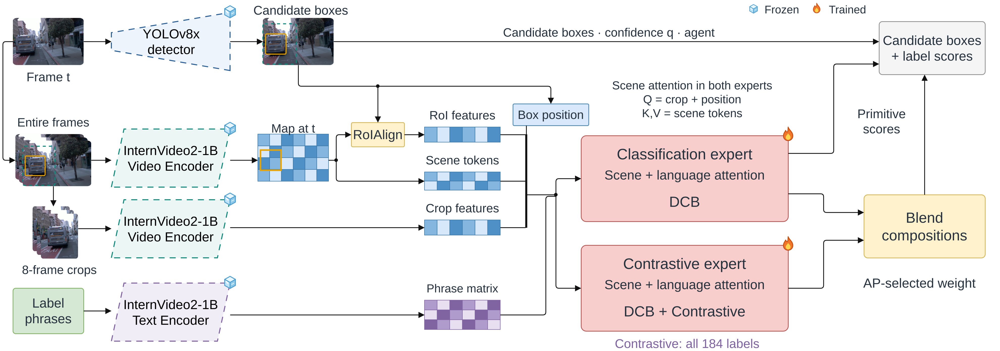
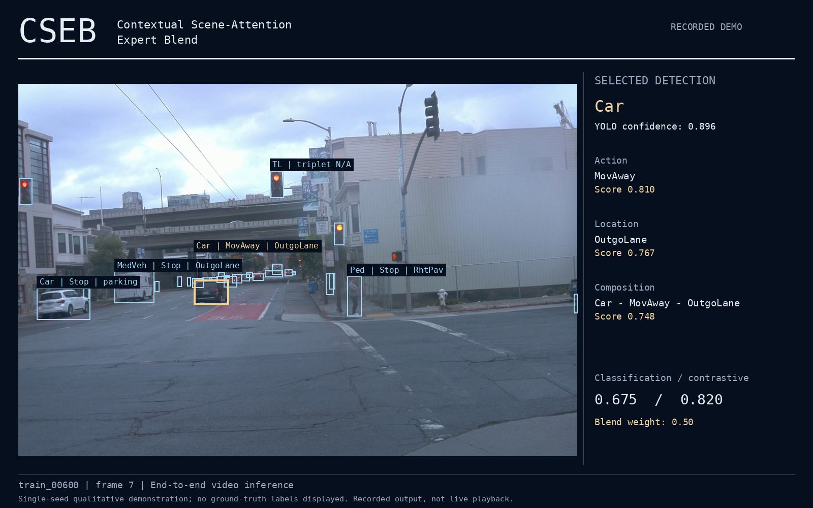

# Intelligent_AutoDrive — Compositional Road-Event Detection

Master's thesis research by **Brandon L. Byrd**, supervised by **Dr. Hamidreza Moradi** at **North Carolina A&T State University**.

This repository studies how object appearance, scene context, and language representations can support **agent–action–location detection on ROAD-Waymo**, including rare combinations. The work progresses from RoI classifiers and semantic crop models to **CSEB: Contextual Scene-Attention Expert Blend**, the headline architecture. The thesis has been successfully defended; the journal extension is in progress.

**[Architecture catalog](docs/architectures/README.md)** · **[Real-time student](research/post-proposal/cseb-student/REALTIME.md)** · **[Analysis demo](research/post-proposal/demo/README.md)** · **[Verified results](research/post-proposal/results-snapshots/20261019-headline/README.md)** · **[Code and study index](research/post-proposal/STUDY-INDEX.md)**

## Research question

Can language-conditioned scoring and visual scene context improve compositional road-event detection, particularly for infrequent agent–action–location combinations?

Recognizing a car is only part of the task. The model also predicts what it is doing and where that action occurs: for example, **Car · MovAway · OutgoLane**. ROAD-Waymo provides a fixed vocabulary of agents, actions, locations, and valid compositions. A box may have multiple labels, and rare compositions make overall performance alone an incomplete measure.

The experiments examine three modeling decisions: how to represent an individual road user, how to incorporate the surrounding scene, and how to combine experts trained with different objectives. Evaluations report overall composition performance alongside common, tail, and deep-tail triplets.

## Headline model: CSEB



[Architecture details and editable diagram](docs/architectures/cseb-scaled/README.md) · [Tensor and evaluation contract](docs/architectures/CONTRACT.md)

For each candidate box, the model uses **crops, RoI features, and the entire frame**, together with an embedding of the box position:

1. **Localize:** the ROAD-trained YOLOv8x detector proposes boxes and agent classes.
2. **Encode visual evidence:** a frozen InternVideo2 video encoder processes an eight-frame expanded crop and the entire-frame clip. RoIAlign extracts actor context from the full-frame feature map; pooled spatial tokens preserve scene context.
3. **Fuse context and phrases:** trainable projections, residual adapters, scene attention, and language cross-attention form the contextual representation. Scene attention uses the projected crop plus geometry as its query; entire-frame tokens supply keys and values. Label phrases come from the frozen text encoder and pass through trainable text projections/adapters.
4. **Train complementary experts:** both experts use difficulty-calibrated BCE (DCB). The second also uses contrastive learning across all 184 outputs, aligning the visual representation before language fusion with adapted phrase embeddings.
5. **Blend composition predictions:** a scalar selected by development AP combines the experts' composition scores. Primitive scores are carried forward from the classification expert.

For the 135 composition scores:

```text
p_blend = (1 − α) × p_classification + α × p_contrastive
```

The weight α is fixed after selection on the reserved development subset. Each expert produces 184 logits. The blend preserves the classification expert's first 49 outputs and combines the remaining 49 duplex and 86 triplet outputs. Final detector assembly uses YOLO agent classes/confidence and multiplies semantic scores by candidate confidence.

**Both experts contain scene and language attention.** The classification expert is trained with DCB; the contrastive expert adds the auxiliary contrastive objective. The contextual experts use a flat 184-output readout.

The scaled configuration uses the **InternVideo2-CLIP-1B encoder system**: 1,408-dimensional visual features and a 184×768 phrase bank projected into the 512-dimensional head. The matching text weights originate from InternVL. The scaled system uses larger video and text encoders.

### What this work changes

YOLO, pretrained InternVideo2/InternVL encoders, and RoIAlign are inherited components. The implemented modeling work combines actor crops, RoI context, entire-frame tokens, geometry, and adapted label phrases; studies alternative fusion/readout/loss designs; and evaluates a development-selected expert blend under a common detector protocol. DCB is adapted from FRCB, with the local weighting/reduction documented in the [DCB architecture page](docs/architectures/context-dcb/README.md) and [training protocol](research/post-proposal/contextual-roi-1b/protocol.json).

## Model progression

| Family | Models and question |
|---|---|
| Detection and RoI scoring | [Stage 0](docs/architectures/stage-0/README.md): 3D-RetinaNet baseline. [Stage 1](docs/architectures/stage-1/README.md): Score Transfer. [Stage 2](docs/architectures/stage-2/README.md): RoI Linear Scoring Head. [Stage 3](docs/architectures/stage-3/README.md): add Composition MLP. |
| Semantic crop classification | [Stage 4](docs/architectures/stage-4/README.md): Semantic Crop Classifier using phrase scoring. [Stage 5](docs/architectures/stage-5/README.md): crop features and flat primitive scores feed a Comp MLP. [Stage 6](docs/architectures/stage-6/README.md): add explicit phrase-composition scores to that MLP. |
| Context fusion | Add RoI features, entire-frame tokens, and geometry to crops. Compare [mean pooling](docs/architectures/context-mean-pool/README.md) with [scene attention](docs/architectures/context-scene-attention/README.md), and study [all-label contrastive supervision](docs/architectures/context-scene-attention-contrastive/README.md). |
| Expert blending and scaling | Combine classification and contrastive experts using [development AP selection](docs/architectures/context-expert-blend/README.md), apply [DCB training](docs/architectures/context-dcb/README.md), and scale to the [headline CSEB configuration](docs/architectures/cseb-scaled/README.md). |

The [illustrated catalog](docs/architectures/README.md) also documents encoder adaptation, composition readouts, skip connections, learned gates, and language controls. These are documented as separate experimental branches. Stage numbers identify architectures; experiment folder numbers and spreadsheet row numbers identify study history.

## Verified headline results

**ROAD-Waymo validation detector frame-mAP at IoU 0.5, percent; mean over seeds 0, 1, and 2.** All three configurations below use the same scaled encoder features, YOLO candidates, and locked set of **36,717 validation frames**.

| Scaled scene-attention configuration | Action | Location | Duplex | Triplet | Tail 47 | Deep tail 28 |
|---|---:|---:|---:|---:|---:|---:|
| Classification expert — DCB | 24.75 | 29.64 | 23.37 | 15.03 | 8.40 | 6.05 |
| Contrastive expert — DCB + all-184 contrastive | 24.85 | 29.88 | 23.53 | 15.08 | 8.53 | 5.99 |
| **CSEB — AP-selected blend** | **24.75** | **29.64** | **24.36** | **15.75** | **9.00** | **6.35** |

CSEB's triplet result is **15.75 ± 0.27**, tail-47 **9.00 ± 0.64**, and deep-tail-28 **6.35 ± 0.57** (sample standard deviation across three seeds). Agentness and agent mAP are **65.36** and **35.25**, respectively, inherited from the shared YOLO detections. Common-39 triplet mAP is **23.88**.

The blend carries forward the classification expert’s primitive scores and combines both experts’ composition scores.

[Summary with per-seed values](research/post-proposal/results-snapshots/20261019-headline/scaled-cseb/full-summary.json) · [Raw detector results and source hashes](research/post-proposal/results-snapshots/20261019-headline/README.md)

## Evaluation contract

- **Outputs:** 1 agentness + 10 agents + 22 actions + 16 locations + 49 duplexes + 86 triplets = **184**. Agentness is included in the 49 primitive outputs.
- **Training versus detection:** semantic heads learn from GT-positive/background training inputs; detector evaluation uses YOLO proposals. Development crop AP and retrieval metrics are separate from detector frame-mAP.
- **Selection:** the scaled study uses 420 expert-training videos, 90 development videos, and 90 reserved gate videos. The scalar blend is selected on the established 45-video selector subset. Checkpoints use development triplet crop AP.
- **Frequency groups:** tail-47 uses training-frequency z < 0; deep-tail-28 uses z < −0.5; common-39 uses z ≥ 0. These are subsets of the 86 triplet classes, not all semantic classes.

Valid compositions are derived from label strings and verified constraints. See the [shared contract](docs/architectures/CONTRACT.md) for the label mapping.

## Real-time student

The [distilled causal student](research/post-proposal/cseb-student/REALTIME.md) is the current real-time inference option. It shares one frame encoder across detections, carries a small scene-memory state, and processes video or camera input at the trained **10 Hz** cadence. Its semantic model has **9.65M parameters**, plus the ROAD YOLO detector.

The packaged runner processed a 120-frame video in **5.64 seconds**, including decoding, inference and score export, with **0.91 seconds** loading on an RTX A6000. It provides optional live triplet overlays and full prediction exports. [Runtime check](research/post-proposal/cseb-student/runtime-package-validation.json)

```bash
python research/post-proposal/cseb-student/live.py \
  --bundle /path/to/student-bundle \
  --source /path/to/video.mp4 --display --output /path/to/new-run
```

Use `--source 0` for a camera. [Environment setup, workstation command and portable weight export](research/post-proposal/cseb-student/REALTIME.md).

The initial student pilot improved triplet proposal AP from 11.6% with supervised-only training to 24.1% with distillation on its small held-out subset. [Pilot protocol and metrics](research/post-proposal/cseb-student/README.md). A separate [expanded-data candidate](research/post-proposal/cseb-student/EXPANSION.md) retains the current runtime bundle while training on more videos.

## End-to-end prototype

[](research/post-proposal/demo/README.md)

**[Watch/download the 12-second example](docs/assets/cseb-prototype.mp4)** · **[Download the interactive viewer](docs/assets/cseb-demo.html)** · **[Setup and controls](research/post-proposal/demo/README.md)**

Download `cseb-demo.html` and open it in a browser to explore the recorded example. The viewer includes its frames and predictions and works offline.

For reusable inference without analysis exports, see the [GPU-resident inference runner](research/post-proposal/demo/DEPLOYMENT.md).

The prototype accepts raw video and runs fresh YOLO detection, fresh visual encoding, and both trained experts. It exports an annotated MP4 and a self-contained HTML viewer with selectable boxes, triplet overlays, expert comparisons, and a confidence filter. The fixed phrase bank is loaded from the checkpoint. No ground-truth annotations or previously computed visual features are required for raw-video inference.

On one RTX A6000, the recorded 120-frame example processed 3,634 proposals in **358.93 seconds**, including rendering. Visual encoding took **325.26 seconds**; both expert heads together took **2.16 seconds**. The **offline prototype** uses eight-frame windows and exports video at 10 fps.

The demo uses a ROAD-Waymo validation sequence with YOLO confidence **0.25**; detector evaluation uses **0.001**. The threshold is configurable. [Runtime verification](research/post-proposal/results-snapshots/20261019-headline/demo-verification.json)

### Run on a new video

Use a compatible CUDA/PyTorch environment and follow the [demo asset setup](research/post-proposal/demo/README.md) to install dependencies and register the exact encoder weights. YOLO weights, trained CSEB heads, dataset videos, and encoder checkpoints are stored separately. The demo guide lists the runtime dependencies and asset setup.

```bash
python research/post-proposal/demo/infer_video.py \
  --video /path/to/input.mp4 \
  --checkpoint /path/to/attention-global-dcb-seed0/best.pt \
  --encoder-root /path/to/verified-encoder-runtime \
  --yolo /path/to/road-yolov8x/best.pt \
  --output /path/to/new-demo-run \
  --frames 120
```

Open the generated `viewer/index.html` or `viewer/cseb-prototype.mp4`. The demo README also provides the tested workstation command and a cached-input mode for faster inspection.

## Repository guide

```text
docs/architectures/                 Illustrated model catalog and shared contracts
docs/assets/                       Prototype preview and example video
experiments/                       Earlier detector, RoI, crop, and adaptation studies
research/post-proposal/
  contextual-roi*/                  Contextual heads, losses, controls, and scaled encoders
  contextual-gate/                  Learned gate alternatives
  contextual-road-transfer/         ROAD-adapted encoder transfer study
  stage56-full/                     Stage 5/6 encoder-adaptation study
  stage7-stage5/                    Contextual refinement of Stage 5
  demo/                            Raw-video inference, viewer, and MP4 rendering
  cseb-student/                    Real-time student, portable export, training and monitoring
  reporting/                       Result collection and workbook tools
  results-snapshots/                Compact evidence with provenance
  monitoring/                      Experiment monitoring and recovery tools
  historical/                      Archived source versions
```

Start from the [study index](research/post-proposal/STUDY-INDEX.md) and the relevant architecture README before reproducing a run. Preserve the protocol, label order, split manifests, pretrained revisions, and checkpoint-selection rule. Some historical launchers contain lab/NCShare paths and require environment-specific setup.

Run the prototype checks in the configured environment:

```bash
python -m unittest discover -s research/post-proposal/demo -p 'test_*.py'
```

Seven checks passed on the workstation, including exact GPU preprocessing parity with the original crop pipeline, temporal sampling, primitive-score preservation, and composition blending. Diagram assets retain editable draw.io ancestors and [source hashes](docs/architectures/assets/provenance.json).

## Earlier exploration

The Qwen, SmolVLM, OpenMixer, and neuro-symbolic investigations remain part of the research history. Their original goals and planned components are preserved in the [archived README](docs/ARCHIVED-README.md) and [historical model index](docs/architectures/HISTORY.md). The current headline system predicts structured multilabel road events.
