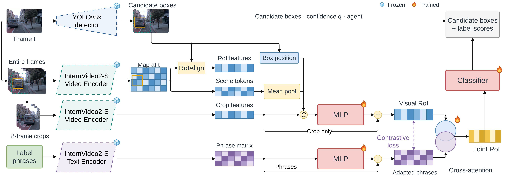

# Contextual + Mean Pool + Focal + All 184 Contrastive

[Architecture index](../README.md) · [Shared tensor and evaluation contract](../CONTRACT.md)

Corrected contrastive objective trains both visual and adapted-text branches.

Established thesis diagram, copied without geometry or label changes. [Editable draw.io](../assets/context-all184.drawio) · [Source paths and SHA-256](../assets/provenance.json).

## Forward path

Inputs: crop vector, actor RoI feature, entire-frame scene tokens, and normalized candidate-box position. Project to 512-D; fuse the four inputs; crop-only residual + LayerNorm creates the visual RoI. Language cross-attention to adapted phrases creates the joint RoI. Concatenate joint RoI (512), projected crop (512), and phrase similarities (184) → MLP(1208,512,184). No Composition MLP in this readout.

## Training and inference

Both pretrained encoders and cached inputs are frozen. Crop/text adapters, projections, geometry MLP, fusion MLP, language attention and classifier train. Classification covers all 184 channels; “classification only” means no contrastive auxiliary, not no language. See the shared contract for final YOLO score assembly. λ=0.001 multi-positive contrastive loss aligns normalized pre-language visual RoI with adapted phrase embeddings across all 184 columns, temperature 0.07. Contrastive gradients reach both adapters; they do not directly supervise the downstream joint RoI or classifier logits.

## Implementation

- [model.py](../../../research/post-proposal/contextual-roi-all184/model.py) — `research/post-proposal/contextual-roi-all184/model.py`
- [protocol.json](../../../research/post-proposal/contextual-roi-all184/protocol.json) — `research/post-proposal/contextual-roi-all184/protocol.json`

## Variants and interpretation

Rows with no positive target are excluded from auxiliary loss. 184 includes agentness, primitives and compositions; it is not 184 triplet classes.
