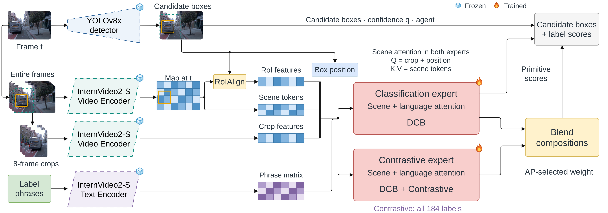

# Contextual + Scene Attention + Expert Blend + DCB

[Architecture index](../README.md) · [Shared tensor and evaluation contract](../CONTRACT.md)

Same two-expert inference topology; difficulty-calibrated BCE replaces focal classification.

Established thesis diagram, copied without geometry or label changes. [Editable draw.io](../assets/context-dcb.drawio) · [Source paths and SHA-256](../assets/provenance.json).

## Forward path

Identical to the focal expert blend: classification expert supplies primitives; global AP-selected blend supplies compositions. Both experts contain scene and language attention. DCB is only a training objective, not an inference layer.

## Training and inference

Per-entry detached BCE multiplier is 0.5+y(1−sigmoid(z))+historical mean positive residual. History includes prior batches only, persists across training, and is updated after weighting. Classification expert uses DCB; contrastive expert adds 0.001 all 184 auxiliary. Mean reduction over box×label entries is a documented local adaptation of FRCB-inspired DCB.

## Implementation

- [model.py](../../../research/post-proposal/contextual-roi-dcb/model.py) — `research/post-proposal/contextual-roi-dcb/model.py`
- [dcb.py](../../../research/post-proposal/contextual-roi-dcb/dcb.py) — `research/post-proposal/contextual-roi-dcb/dcb.py`
- [prepare_blend.py](../../../research/post-proposal/contextual-roi-dcb/prepare_blend.py) — `research/post-proposal/contextual-roi-dcb/prepare_blend.py`
- [protocol.json](../../../research/post-proposal/contextual-roi-dcb/protocol.json) — `research/post-proposal/contextual-roi-dcb/protocol.json`

## Variants and interpretation

DCB does not establish improvement on every rare-class subset. The small-encoder DCB blend is workbook model 104; workbook row numbers are not architecture IDs.
