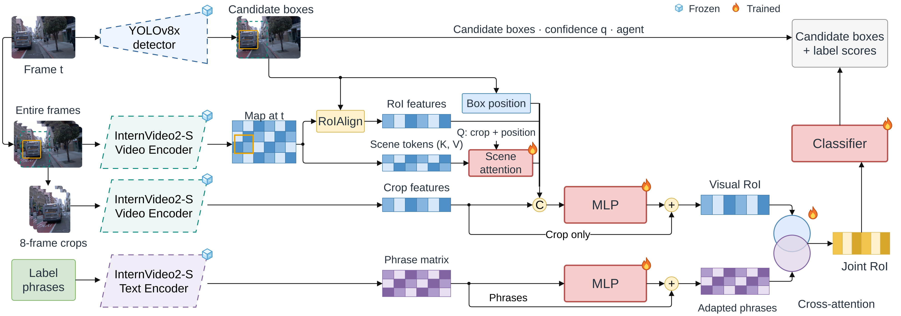

# Contextual + Full-Context Concatenative Skip (ablation)

[Architecture index](../README.md) · [Shared tensor and evaluation contract](../CONTRACT.md)

A distinct skip ablation, not the crop-only residual in the headline model.

Shared scene-attention parent diagram; its crop-only visual-MLP skip is replaced by the full-context skip specified below. This established figure is not an exact rendering of the ablation. [Editable draw.io](../assets/context-attention.drawio) · [Source paths and SHA-256](../assets/provenance.json).

## Forward path

Let x=[c,r,scene summary,g] (2048), e=MLP(x) (512). Replace visual RoI LN(c+e) by LN(W[x,e]) with trainable 2560→512 projection. Initialize W to select c+e exactly; language attention and flat 184 classifier unchanged.

## Training and inference

DCB classification/all 184 auxiliary arms and their AP-selected blends. Adds 1,310,720 parameters; initialization matches the parent but extra capacity is a confound.

## Implementation

- [model.py](../../../research/post-proposal/contextual-roi-concat/model.py) — `research/post-proposal/contextual-roi-concat/model.py`
- [protocol.json](../../../research/post-proposal/contextual-roi-concat/protocol.json) — `research/post-proposal/contextual-roi-concat/protocol.json`
