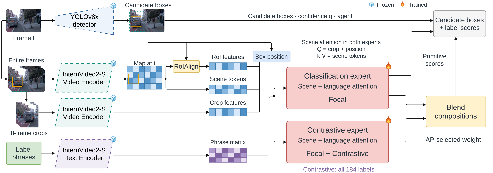

# Contextual Expert Gates (supporting alternatives)

[Architecture index](../README.md) · [Shared tensor and evaluation contract](../CONTRACT.md)

Supporting classwise and sample-conditioned routing alternatives to the global AP-selected blend.

Shared expert-input/output illustration; replace its scalar blend selector with the learned router described below. This is not evidence that learned gates were used in the headline result. [Editable draw.io](../assets/context-blend.drawio) · [Source paths and SHA-256](../assets/provenance.json).

## Forward path

Frozen expert probabilities and pooled actor descriptors → classwise, generic actor/class, or factorized primitive gate → composition probability mixture. Primitive predictions stay on the classification path.

## Training and inference

The router uses support-based shrinkage toward a global anchor. Gate fitting/selection use reserved development data. These learned gates are not the simple scalar selector used by headline CSEB.

## Implementation

- [router.py](../../../research/post-proposal/contextual-gate/router.py) — `research/post-proposal/contextual-gate/router.py`
- [train_gate.py](../../../research/post-proposal/contextual-gate/train_gate.py) — `research/post-proposal/contextual-gate/train_gate.py`
- [protocol.json](../../../research/post-proposal/contextual-gate/protocol.json) — `research/post-proposal/contextual-gate/protocol.json`
