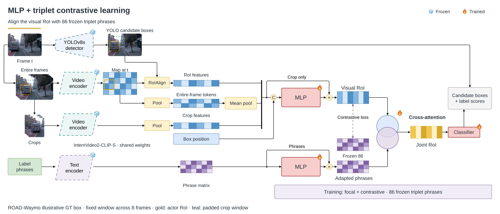

# Contextual + Mean Pool + Focal + Triplet Contrastive (historical)

[Architecture index](../README.md) · [Shared tensor and evaluation contract](../CONTRACT.md)

Historical auxiliary-loss design retained to explain the correction.

Historical 86-triplet figure. Its frozen target bank is intentional for this old condition; do not relabel it as corrected all184. [Editable draw.io](../assets/context-triplet.drawio) · [Source paths and SHA-256](../assets/provenance.json).

## Forward path

Inputs: crop vector, actor RoI feature, entire-frame scene tokens, and normalized candidate-box position. Project to 512-D; fuse the four inputs; crop-only residual + LayerNorm creates the visual RoI. Language cross-attention to adapted phrases creates the joint RoI. Concatenate joint RoI (512), projected crop (512), and phrase similarities (184) → MLP(1208,512,184). No Composition MLP in this readout.

## Training and inference

Both pretrained encoders and cached inputs are frozen. Crop/text adapters, projections, geometry MLP, fusion MLP, language attention and classifier train. Classification covers all 184 channels; “classification only” means no contrastive auxiliary, not no language. See the shared contract for final YOLO score assembly. Add λ=0.001 multi-positive contrastive loss at temperature 0.07 between pre-language visual RoI and original frozen triplet phrase targets (columns 98:184). Classification still trains the text adapter; this contrastive path does not.

## Implementation

- [model.py](../../../research/post-proposal/contextual-roi/model.py) — `research/post-proposal/contextual-roi/model.py`
- [protocol.json](../../../research/post-proposal/contextual-roi/protocol.json) — `research/post-proposal/contextual-roi/protocol.json`

## Variants and interpretation

The corrected all 184 experiment changes BOTH supervised label scope and the target branch to adapted text. Its comparison is not a clean scope-only ablation.
