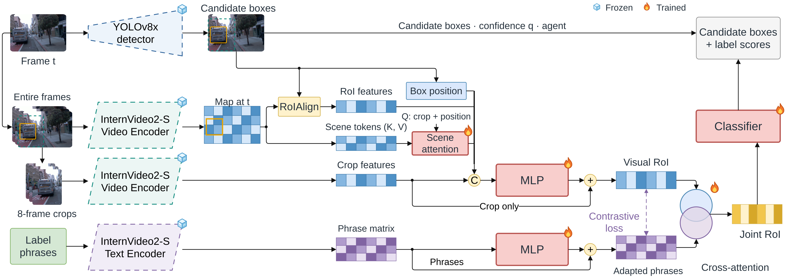

# Language Controls and No-Composition Baselines

[Architecture index](../README.md) · [Shared tensor and evaluation contract](../CONTRACT.md)

Controls test phrase dependence while preserving the appropriate parent architecture and protocol.

Parent contextual all184 architecture. The phrase-bank substitution is a study condition, not a new architecture; scaled controls use the scaled dimensions in their protocol. [Editable draw.io](../assets/context-attention-all184.drawio) · [Source paths and SHA-256](../assets/provenance.json).

## Forward path

Replace ordered phrase prototypes according to the language-control protocol (real/shuffled/random conditions), leaving the designated architecture fixed. Small and scaled studies have different feature/text dimensions and must not be merged. Separately, a crop-only flat linear head omits both phrase fusion and CompMLP.

## Training and inference

Control geometry, trainable capacity, seeds and selection matter. Random prototypes preserve a label-indexed branch; they are not identical to removing language-related capacity. Real-versus-random results do not establish that all language content is irrelevant.

## Implementation

- [model.py](../../../research/post-proposal/contextual-roi-langctl/model.py) — `research/post-proposal/contextual-roi-langctl/model.py`
- [protocol.json](../../../research/post-proposal/contextual-roi-langctl/protocol.json) — `research/post-proposal/contextual-roi-langctl/protocol.json`
- Local study source: `research/post-proposal/contextual-roi-1b-langctl/model.py`
- Local study source: `research/post-proposal/contextual-roi-1b-langctl/protocol.json`
- [train_clip_head.py](../../../experiments/exp12_phrase_head/train_clip_head.py) — `experiments/exp12_phrase_head/train_clip_head.py`
