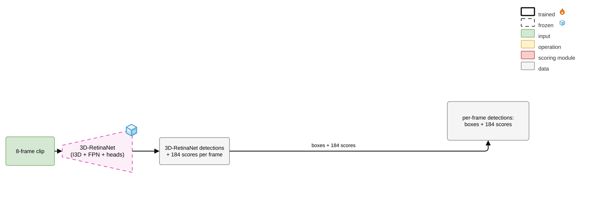

# Stage 0: 3D-RetinaNet (I3D)

[Architecture index](../README.md) · [Shared tensor and evaluation contract](../CONTRACT.md)

Published detector baseline and local replication; retain their separate result identities.

Established thesis diagram, copied without geometry or label changes. [Editable draw.io](../assets/stage0.drawio) · [Source paths and SHA-256](../assets/provenance.json).

## Forward path

Video clip → I3D backbone → feature pyramid → box regression and multi-label detection scores. This baseline proposes its own boxes; YOLO is not in this path.

## Training and inference

Pretrained detector weights are frozen when later stages use I3D features. A local replication is not interchangeable with the published validation or test number.

## Implementation

- [model.py](../../../experiments/exp4_retinamoon/model.py) — `experiments/exp4_retinamoon/model.py`
- [eval_i3d_fullcand.py](../../../experiments/exp11_yolo/eval_i3d_fullcand.py) — `experiments/exp11_yolo/eval_i3d_fullcand.py`

## Variants and interpretation

The wrapper lives in the historical RetinaMoon experiment, but Stage 0 is the unaugmented detector. Its external baseline code/checkpoint is an explicit dependency; it is not bundled in these docs.
