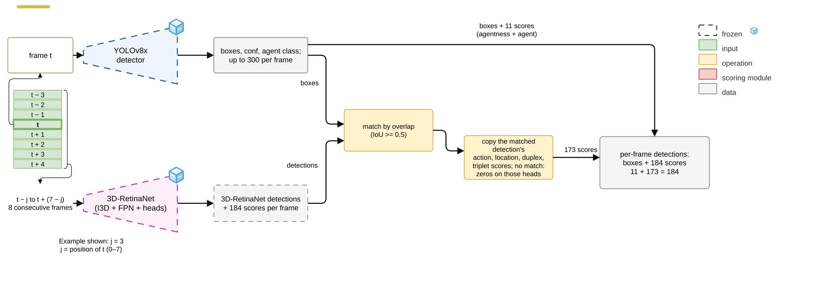

# Stage 1: Score Transfer

[Architecture index](../README.md) · [Shared tensor and evaluation contract](../CONTRACT.md)

Replace localization with YOLO while transferring existing I3D semantic scores.

Established thesis diagram, copied without geometry or label changes. [Editable draw.io](../assets/stage1.drawio) · [Source paths and SHA-256](../assets/provenance.json).

## Forward path

YOLO candidate box → best-overlapping I3D detection (IoU ≥ 0.5) → transferred action/location/duplex/triplet probabilities. Unmatched candidates receive zero transferred semantic scores. YOLO supplies agentness and agent scores.

## Training and inference

No transfer head is trained. This control separates a box-source change from learning a new semantic classifier.

## Implementation

- [eval_hybrid_score_transfer.py](../../../experiments/exp11_yolo/eval_hybrid_score_transfer.py) — `experiments/exp11_yolo/eval_hybrid_score_transfer.py`
