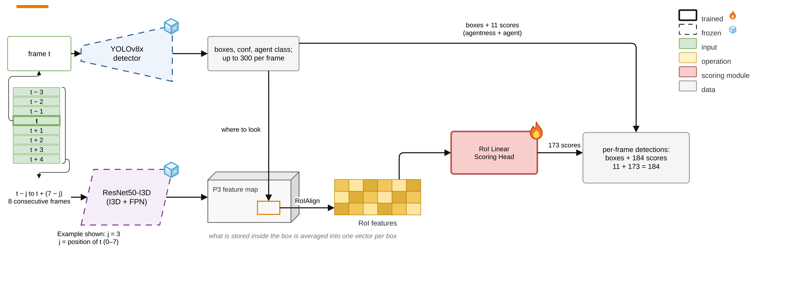

# Stage 2: RoI Linear Scoring Head

[Architecture index](../README.md) · [Shared tensor and evaluation contract](../CONTRACT.md)

Learn semantic scores at the YOLO box coordinates instead of copying an overlapping detection.

Established thesis diagram, copied without geometry or label changes. [Editable draw.io](../assets/stage2.drawio) · [Source paths and SHA-256](../assets/provenance.json).

## Forward path

YOLO candidates → RoIAlign on frozen I3D P3 features (stride 8, 256 channels, 1×1 output, aligned=True) → 256-D vector → Linear(256,184) → sigmoid scores.

## Training and inference

Training uses GT positive boxes plus background negatives; the recorded recipe also includes YOLO junk negatives. Official detector evaluation uses YOLO candidates. Focal classification covers all 184 channels; constraint-weight experiments are separate variants.

## Implementation

- [cache_roi_feats.py](../../../experiments/exp11_yolo/cache_roi_feats.py) — `experiments/exp11_yolo/cache_roi_feats.py`
- [train_head.py](../../../experiments/exp11_yolo/train_head.py) — `experiments/exp11_yolo/train_head.py`
- [eval_head.py](../../../experiments/exp11_yolo/eval_head.py) — `experiments/exp11_yolo/eval_head.py`

## Variants and interpretation

Do not confuse this 1×1 I3D RoIAlign with the later contextual encoder 7×7 RoIAlign followed by spatial mean.
