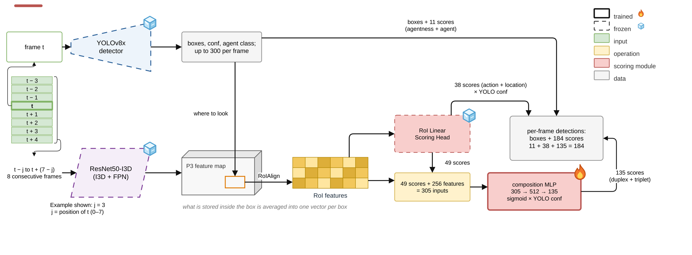

# Stage 3: RoI Linear Scoring Head + Composition MLP

[Architecture index](../README.md) · [Shared tensor and evaluation contract](../CONTRACT.md)

Add a learned composition readout to the I3D RoI classifier.

Established thesis diagram, copied without geometry or label changes. [Editable draw.io](../assets/stage3.drawio) · [Source paths and SHA-256](../assets/provenance.json).

## Forward path

Stage 2 primitive probabilities (49) → Linear(49,512) → ReLU → Linear(512,135) for duplex/triplet logits. Preserve primitive outputs separately in final assembly.

## Training and inference

Composition training uses out-of-fold primitive predictions. Inference uses the fitted primitive head; confidence weighting happens after composition prediction.

## Implementation

- [train_comp_mlp.py](../../../experiments/exp11_yolo/train_comp_mlp.py) — `experiments/exp11_yolo/train_comp_mlp.py`
- [eval_head.py](../../../experiments/exp11_yolo/eval_head.py) — `experiments/exp11_yolo/eval_head.py`

## Variants and interpretation

The `sigfeat` variant appends the 256-D RoI feature; the `sig` variant uses scores alone. `--no-oof` is a training-protocol ablation, not a new stage.
