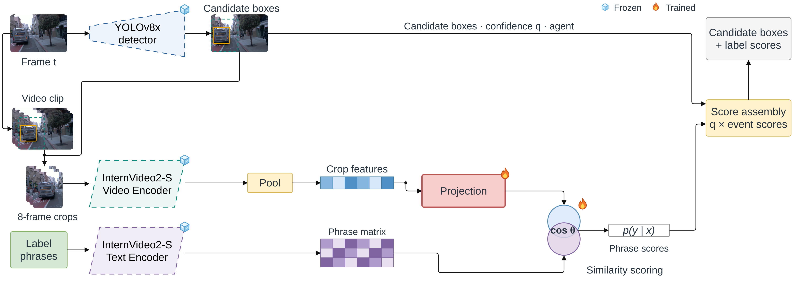

# Stage 4: Semantic Crop Classifier

[Architecture index](../README.md) · [Shared tensor and evaluation contract](../CONTRACT.md)

Score label phrases against a learned projection of an eight-frame crop feature.

Established thesis diagram, copied without geometry or label changes. [Editable draw.io](../assets/stage4.drawio) · [Source paths and SHA-256](../assets/provenance.json).

## Forward path

YOLO candidate → padded eight-frame image crop sequence → frozen InternVideo 2-S video encoder → one 1024-D crop feature → learned projection to phrase space → calibrated cosine similarity with the 184×512 phrase bank → sigmoid scores.

## Training and inference

Frozen encoder features and phrase embeddings; train projection/calibration. Head training positives are GT-derived, with negatives; final detection uses YOLO candidates. This stage does not use contextual RoIAlign or a Composition MLP.

## Implementation

- [train_clip_head.py](../../../experiments/exp12_phrase_head/train_clip_head.py) — `experiments/exp12_phrase_head/train_clip_head.py`
- [cache_crop_feats.py](../../../experiments/exp12_phrase_head/cache_crop_feats.py) — `experiments/exp12_phrase_head/cache_crop_feats.py`
- [eval_clip_head.py](../../../experiments/exp12_phrase_head/eval_clip_head.py) — `experiments/exp12_phrase_head/eval_clip_head.py`

## Variants and interpretation

Flat crop Linear(1024,184) is a separate no-phrase baseline. The historical folder `exp12_phrase_head` does not redefine the presentation stage numbering.
