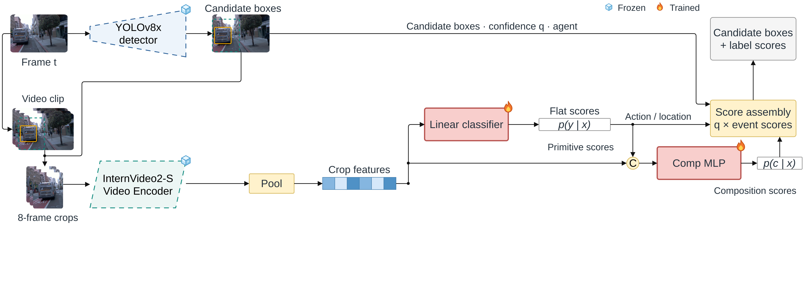

# Stage 5: Semantic Crop Classifier + Comp MLP

[Architecture index](../README.md) · [Shared tensor and evaluation contract](../CONTRACT.md)

Visual composition model: crop features and flat primitive scores; no explicit phrase-score input.

Established thesis diagram, copied without geometry or label changes. [Editable draw.io](../assets/stage5.drawio) · [Source paths and SHA-256](../assets/provenance.json).

## Forward path

Crop vector x (1024) → flat linear head → primitive sigmoids (49). Concatenate [primitive scores,x] (1073) → Linear(1073,512) → ReLU → Linear(512,135). Carry primitive scores into final output alongside new composition scores.

## Training and inference

Frozen cached encoder, separately trained flat head and out-of-fold composition MLP. Model family name is presentation-consistent; it does not mean the Stage 5 readout consumes phrase embeddings.

## Implementation

- [train_clip_head.py](../../../experiments/exp12_phrase_head/train_clip_head.py) — `experiments/exp12_phrase_head/train_clip_head.py`
- [train_comp_mlp_crop.py](../../../experiments/exp12_phrase_head/crop_full/train_comp_mlp_crop.py) — `experiments/exp12_phrase_head/crop_full/train_comp_mlp_crop.py`
- [eval_clip_head.py](../../../experiments/exp12_phrase_head/eval_clip_head.py) — `experiments/exp12_phrase_head/eval_clip_head.py`

## Variants and interpretation

`--prims phrase` is a distinct phrase-primitive composition variant, not the canonical flat-primitive Stage 5. ROAD/BDD-X adaptation changes the encoder condition, not the stage identity.
