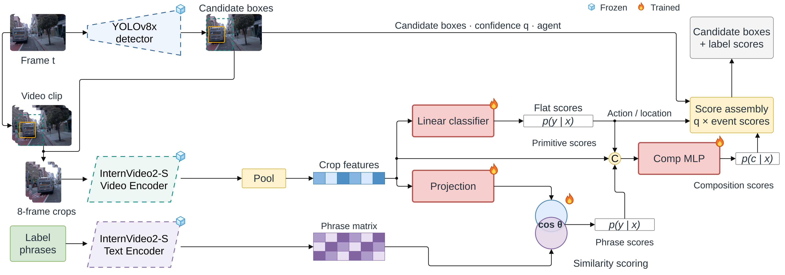

# Stage 6: Semantic Crop Classifier + Phrase Fusion + Comp MLP

[Architecture index](../README.md) · [Shared tensor and evaluation contract](../CONTRACT.md)

Extend Stage 5 with explicit phrase-composition evidence.

Established thesis diagram, copied without geometry or label changes. [Editable draw.io](../assets/stage6.drawio) · [Source paths and SHA-256](../assets/provenance.json).

## Forward path

Concatenate flat primitive sigmoids (49), phrase composition sigmoids (135), and crop vector (1024) → 1208-D input → Linear(1208,512) → ReLU → Linear(512,135). Flat primitive scores bypass this MLP into output assembly.

## Training and inference

Flat and phrase heads generate out-of-fold evidence for composition training. Original frozen encoder and BDD-X/ROAD-adapted conditions must remain separate comparisons.

## Implementation

- [train_comp_mlp_fusion.py](../../../experiments/exp12_phrase_head/crop_full/train_comp_mlp_fusion.py) — `experiments/exp12_phrase_head/crop_full/train_comp_mlp_fusion.py`
- [train_clip_head.py](../../../experiments/exp12_phrase_head/train_clip_head.py) — `experiments/exp12_phrase_head/train_clip_head.py`
- [eval_clip_head.py](../../../experiments/exp12_phrase_head/eval_clip_head.py) — `experiments/exp12_phrase_head/eval_clip_head.py`

## Variants and interpretation

Phrase fusion here means concatenated phrase probabilities before Comp MLP. It is not the language cross-attention used by contextual heads.
