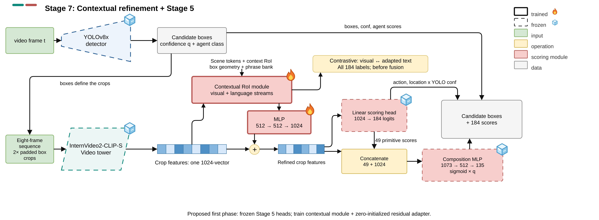

# Stage 7: Contextual Refinement of Frozen Stage 5 Heads

[Architecture index](../README.md) · [Shared tensor and evaluation contract](../CONTRACT.md)

Historical exploratory bridge from contextual features into Stage 5 readout.

Established Stage 7 aligned design illustration. The exact implemented bridge and freeze state are described below; this is not the standalone headline CSEB. [Editable draw.io](../assets/stage7.drawio) · [Source paths and SHA-256](../assets/provenance.json).

## Forward path

Corrected mean-pool contextual backbone → joint RoI512 → MLP bridge 512→512→1024. Add bridge output to original crop x: x′=x+bridge(h). Frozen Stage 5 flat head and CompMLP both consume x′. The standalone contextual classifier is removed.

## Training and inference

Zero-initialize final bridge layer to preserve initial Stage 5 predictions. Train contextual module and bridge; frozen readouts still pass gradients to x′. Focal 184 +0.001 corrected all 184 auxiliary; development-only checkpoint selection.

## Implementation

- [model.py](../../../research/post-proposal/stage7-stage5/model.py) — `research/post-proposal/stage7-stage5/model.py`
- [protocol.json](../../../research/post-proposal/stage7-stage5/protocol.json) — `research/post-proposal/stage7-stage5/protocol.json`
